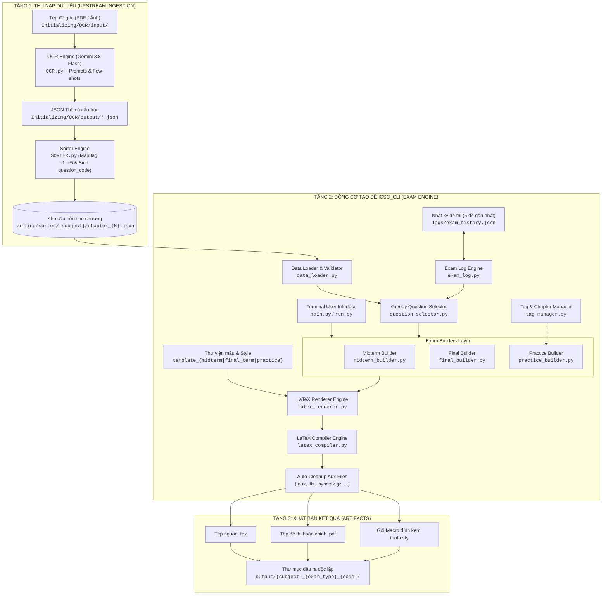
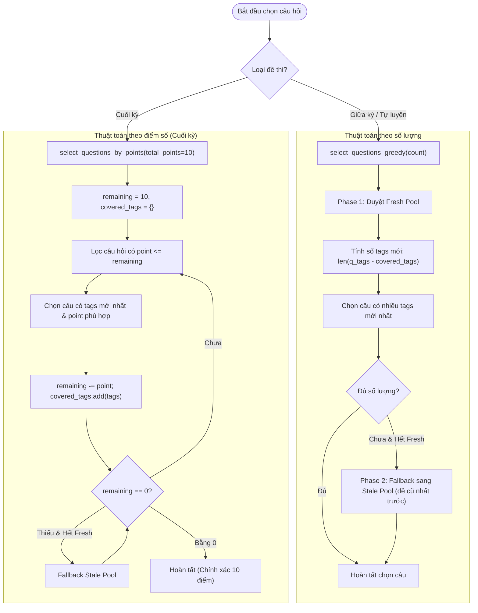
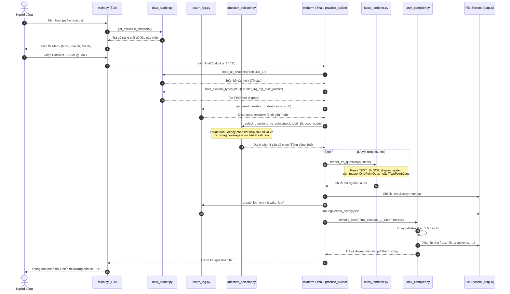

# PIPELINE HOẠT ĐỘNG CHI TIẾT CỦA HỆ THỐNG ICSC_CLI (EXAM GENERATOR)

> **Tài liệu kỹ thuật hệ thống**  
> **Dự án**: ICSC – Intelligent Course Support Center  
> **Phân hệ**: `ICSC_CLI` (Tên module mã nguồn: `exam_generator` / Trình điều khiển: `thoth.py`, `run.py`)  
> **Ngày cập nhật**: 28/10/2026  
> **Phiên bản kiến trúc**: v2.5  

---

## MỤC LỤC
1. [Tổng quan về ICSC và Phân hệ ICSC_CLI](#1-tổng-quan-về-icsc-và-phân-hệ-icsc_cli)
2. [Kiến trúc hệ thống tổng thể (System Architecture)](#2-kiến-trúc-hệ-thống-tổng-thể-system-architecture)
3. [Dữ liệu đầu vào: Pipeline tiền xử lý (Upstream Data Pipeline)](#3-dữ-liệu-đầu-vào-pipeline-tiền-xử-lý-upstream-data-pipeline)
4. [Quy trình hoạt động từng bước của ICSC_CLI (Detailed Step-by-Step Pipeline)](#4-quy-trình-hoạt-động-từng-bước-của-icsc_cli-detailed-step-by-step-pipeline)
   - [Giai đoạn 1: Khởi động và Giao diện tương tác TUI](#giai-đoạn-1-khởi-động-và-giao-diện-tương-tác-tui)
   - [Giai đoạn 2: Nạp và Phân loại dữ liệu câu hỏi (Data Loading & Filtering)](#giai-đoạn-2-nạp-và-phân-loại-dữ-liệu-câu-hỏi-data-loading--filtering)
   - [Giai đoạn 3: Phân tích lịch sử và Khử trùng lặp (Dedup Engine)](#giai-đoạn-3-phân-tích-lịch-sử-và-khử-trùng-lặp-dedup-engine)
   - [Giai đoạn 4: Thuật toán chọn câu hỏi thông minh (Question Selector)](#giai-đoạn-4-thuật-toán-chọn-câu-hỏi-thông-minh-question-selector)
   - [Giai đoạn 5: Quy cách đề thi và Logic đóng gói (Exam Builders)](#giai-đoạn-5-quy-cách-đề-thi-và-logic-đóng-gói-exam-builders)
   - [Giai đoạn 6: Chuyển đổi JSON sang mã nguồn LaTeX (LaTeX Rendering)](#giai-đoạn-6-chuyển-đổi-json-sang-mã-nguồn-latex-latex-rendering)
   - [Giai đoạn 7: Tự động biên dịch PDF và Dọn dẹp tệp phụ (LaTeX Compiler)](#giai-đoạn-7-tự-động-biên-dịch-pdf-và-dọn-dẹp-tệp-phụ-latex-compiler)
   - [Giai đoạn 8: Xuất bản gói đề thi và Ghi nhận lịch sử (Output & Logging)](#giai-đoạn-8-xuất-bản-gói-đề-thi-và-ghi-nhận-lịch-sử-output--logging)
5. [Đặc tả cấu trúc dữ liệu chi tiết (Data Specification)](#5-đặc-tả-cấu-trúc-dữ-liệu-chi-tiết-data-specification)
6. [Sơ đồ tuần tự tương tác (Sequence Diagram)](#6-sơ-đồ-tuần-tự-tương-tác-sequence-diagram)
7. [Xử lý trường hợp biên và Cơ chế an toàn (Edge Cases & Fault Tolerance)](#7-xử-lý-trường-hợp-biên-và-cơ-chế-an-toàn-edge-cases--fault-tolerance)
8. [Hướng dẫn vận hành và Mở rộng hệ thống (Operations & Extension)](#8-hướng-dẫn-vận-hành-và-mở-rộng-hệ-thống-operations--extension)

---

## 1. TỔNG QUAN VỀ ICSC VÀ PHÂN HỆ ICSC_CLI

### 1.1. Sứ mệnh của ICSC
**ICSC** (*Intelligent Course Support Center*) là nền tảng tự động hóa toàn diện quy trình số hóa, phân loại kiến thức và tạo lập ngân hàng đề thi chuẩn hóa cho các môn Toán đại cương tại Đại học Bách Khoa Hà Nội (bao gồm: Giải tích 1, Giải tích 2, Giải tích 3, và Đại số).

### 1.2. Phân hệ ICSC_CLI (Thoth Exam Generator)
`ICSC_CLI` là trung tâm thực thi tạo đề (core exam engine) hoạt động trên giao diện dòng lệnh (CLI / Terminal UI). Phân hệ này chịu trách nhiệm:
1. Tiếp nhận cơ sở dữ liệu câu hỏi đã được cấu trúc hóa theo chương từ tầng tiền xử lý.
2. Tương tác với người dùng để lựa chọn môn học, loại kỳ thi (Giữa kỳ, Cuối kỳ, Tự luyện) và các tiêu chí lọc.
3. Ứng dụng giải thuật tham lam tối ưu hóa độ phủ kiến thức (Greedy Tag Coverage) kết hợp thuật toán tính điểm và khử trùng lặp qua lịch sử 5 đề gần nhất.
4. Chuyển đổi cây cú pháp trừu tượng dạng JSON (`TEXT_BLOCK`, ma trận `matrix`, hệ phương trình/hàm phân nhánh `display_system`) thành mã nguồn LaTeX theo đúng mẫu chuẩn Bách Khoa.
5. Tự động biên dịch ra tệp PDF hoàn chỉnh thông qua trình biên dịch LaTeX cục bộ (`pdflatex`) và đóng gói tài nguyên đi kèm độc lập (`thoth.sty`).

> [!NOTE]
> Trong mã nguồn dự án:
> - Thư mục gốc triển khai của phân hệ là `exam_generator/` (hoặc định danh giao tiếp `ICSC_CLI`).
> - Script khởi chạy nhanh: `run.py` hoặc lệnh chạy trực tiếp `python -m exam_generator`.
> - Giao diện dòng lệnh mang tên vị thần trí tuệ Ai Cập: `thoth.py` / `thoth.bat` đi kèm gói macro định dạng LaTeX `thoth.sty`.

---

## 2. KIẾN TRÚC HỆ THỐNG TỔNG THỂ (SYSTEM ARCHITECTURE)

Hệ thống được thiết kế theo mô hình phân tầng chặt chẽ (layered architecture), tách biệt giữa tầng thu nạp/làm giàu dữ liệu và tầng sinh đề/kết xuất:



---

## 3. DỮ LIỆU ĐẦU VÀO: PIPELINE TIỀN XỬ LÝ (UPSTREAM DATA PIPELINE)

Để `ICSC_CLI` có thể đọc và chọn lọc câu hỏi, dữ liệu phải trải qua quy trình chuẩn hóa gồm 2 giai đoạn do `Initializing/initializer.py` điều phối:

```
[Ảnh/PDF đề thi] ──(OCR.py)──> [JSON Thô] ──(SORTER.py)──> [Database JSON chia theo Chapter]
```

### 3.1. OCR.py — Số hóa nhận dạng toán học bằng Multimodal LLM
- **Cơ chế**: Quét các file ảnh/PDF trong thư mục `Initializing/OCR/input/`.
- **Mô hình AI**: Sử dụng Gemini API (`gemini-3.8-flash`) với cơ chế Few-shot Learning:
  + Gửi kèm hướng dẫn chuẩn `resource/template_v3.md` (quy định cấu trúc JSON, quy tắc nhân đôi backslash `\\`).
  + Gửi kèm danh mục nhãn chuẩn `resource/tags_01_v2.md` và luật giải trừ nhập nhằng (Disambiguation Rules) để AI gán chính xác các nhãn chuyên đề.
  + Gửi kèm các hình ảnh mẫu trong `examples/input/` và JSON mẫu `examples/output/examples.json`.
- **Đầu ra**: Tệp JSON lưu tại `Initializing/OCR/output/YYYY-MM-DD-HH-mm.json`.

### 3.2. SORTER.py — Phân rã và định danh câu hỏi
- **Cơ chế**: Đọc các file JSON mới trong `OCR/output/` (theo dõi qua `.processed_files.json`).
- **Phân loại**: Dựa trên tiền tố của nhãn `section_tags`:
  + `c1_*` $\rightarrow$ Chapter 1
  + `c2_*` $\rightarrow$ Chapter 2
  + `c3_*` $\rightarrow$ Chapter 3
  + `c4_*` $\rightarrow$ Chapter 4
  + `c5_*` $\rightarrow$ Chapter 5
- **Sinh mã câu hỏi duy nhất (`question_code`)**:
  $$\text{question\_code} = \text{YYYY-MM-DD-HH-mm} - \text{order}$$
  Trong đó `order` là số thứ tự tăng dần của câu hỏi trong đợt quét nạp vào chương đó.
- **Lưu trữ**: Ghi vào các tệp cơ sở dữ liệu `Initializing/sorting/sorted/<subject>/chapter_<N>.json`.

---

## 4. QUY TRÌNH HOẠT ĐỘNG TỪNG BƯỚC CỦA ICSC_CLI (DETAILED STEP-BY-STEP PIPELINE)

Dưới đây là chi tiết 8 giai đoạn thực thi khép kín khi người dùng kích hoạt `ICSC_CLI`.

---

### Giai đoạn 1: Khởi động và Giao diện tương tác TUI
**Module phụ trách**: `exam_generator/main.py`

Khi người dùng thực thi `python run.py`, chương trình thiết lập môi trường và thực hiện vòng lặp tương tác:

1. **Hiển thị Banner**: In định danh hệ thống Intelligent Course Support Center.
2. **Chọn môn học (`select_subject()`)**:
   - Quét hệ thống tệp tại `Initializing/sorting/sorted/` để kiểm tra số lượng chapter hiện có.
   - Hiển thị bảng trạng thái dữ liệu dạng Box-Drawing chuẩn xác:
     ```
     ┌─────┬──────────────┬────────────────────┐
     │ STT │   Môn học    │ Trạng thái dữ liệu │
     ├─────┼──────────────┼────────────────────┤
     │  1  │  Calculus 1  │ 3 chapters         │
     │  2  │  Calculus 2  │ Chưa có dữ liệu    │
     │  3  │  Calculus 3  │ Chưa có dữ liệu    │
     │  4  │   Algebra    │ 5 chapters         │
     │  0  │    Thoát     │ -                  │
     └─────┴──────────────┴────────────────────┘
     ```
   - Chặn người dùng chọn các môn chưa có dữ liệu.
3. **Chọn loại đề thi (`select_exam_type()`)**:
   - `1`: Giữa kỳ (Quy cách trắc nghiệm: 10 MCQ_SA + 5 TFQ/MCQ_MA).
   - `2`: Cuối kỳ (Quy cách tự luận: Tổng đúng 10 điểm).
   - `3`: Tự luyện (Tùy biến theo chương hoặc tags kiến thức).
4. **Nhập mã đề thi (`input_exam_code()`)**:
   - Đối với Giữa kỳ: Mặc định mã `102`.
   - Đối với Cuối kỳ: Mặc định mã `1`.
   - Đối với Tự luyện: Bỏ qua bước nhập mã đề.

---

### Giai đoạn 2: Nạp và Phân loại dữ liệu câu hỏi (Data Loading & Filtering)
**Module phụ trách**: `exam_generator/data_loader.py`

1. **Nạp dữ liệu từ đĩa**:
   - Đối với đề giữa kỳ: Chỉ tải các chương được quy định trong `config.MIDTERM_CHAPTERS` (VD: Calculus 1 tải Chapter 1; Algebra tải Chapter 1 và 2).
   - Đối với đề cuối kỳ / tự luyện: Tải toàn bộ các tệp `chapter_*.json` có trong thư mục môn học qua `load_all_chapters()`.
2. **Phân loại câu hỏi theo kiểu bài tập**:
   - **Nhóm trắc nghiệm** (`MCQ_TYPES`): `MCQ_SA` (Trắc nghiệm 1 đáp án), `MCQ_MA` (Nhiều đáp án đúng), `TFQ` (Đúng/Sai).
   - **Nhóm tự luận** (`FRQ_TYPES`): `FRQ_SP` (Tự luận đơn ý), `FRQ_MP` (Tự luận nhiều ý $a, b, c...$).
3. **Bộ lọc chuyên biệt cho đề cuối kỳ**:
   - `filter_exclude_types(..., MCQ_TYPES)`: Loại bỏ 100% câu hỏi trắc nghiệm.
   - `filter_frq_mp_max_parts(..., max_parts=2)`: Đề cuối kỳ chuẩn chỉ chấp nhận các câu tự luận có tối đa 2 ý (a và b). Các câu FRQ_MP có từ 3 ý trở lên bị loại bỏ để đảm bảo cân bằng thời gian thi.
4. **Quy tắc chuẩn hóa điểm số (`get_question_point(question)`)**:
   - Nếu câu hỏi có trường `point` khác `null`: lấy giá trị nguyên `int(point)`.
   - Nếu trường `point` bằng `null`:
     + Với câu hỏi `FRQ_MP`: Số điểm tự động tính bằng số lượng ý (mặc định 2 điểm cho 2 ý a, b).
     + Với câu hỏi `FRQ_SP`: Gán mặc định là 1 điểm (`FINAL_DEFAULT_POINT = 1`).

---

### Giai đoạn 3: Phân tích lịch sử và Khử trùng lặp (Dedup Engine)
**Module phụ trách**: `exam_generator/exam_log.py`

Để đảm bảo các đề thi được tạo liên tiếp không bị lặp lại các câu hỏi đã xuất hiện, hệ thống quản lý lịch sử thông qua `logs/exam_history.json`:

1. **Đọc lịch sử (Rolling Window)**:
   - Hệ thống duy trì tối đa `LOG_HISTORY_SIZE = 5` đề gần nhất cho từng môn học.
2. **Tính toán trọng số thời gian (`recency`)**:
   - Quét ngược danh sách lịch sử từ mới nhất đến cũ nhất.
   - Gán chỉ số `recency` cho từng mã câu hỏi đã xuất hiện:
     + `recency = 0`: Câu hỏi vừa xuất hiện trong đề gần nhất (mức độ ưu tiên tránh cao nhất).
     + `recency = 1`: Câu hỏi xuất hiện trong đề gần thứ 2.
     + `recency = 4`: Câu hỏi xuất hiện trong đề xa nhất trong cửa sổ 5 đề.
3. **Phân rã bể câu hỏi (Pool Partitioning)**:
   - **Tập Fresh (Mới)**: Gồm các câu hỏi chưa từng xuất hiện trong 5 đề gần nhất (`code not in used_codes`).
   - **Tập Stale (Cũ)**: Gồm các câu hỏi đã từng dùng, được sắp xếp theo thứ tự ưu tiên giảm dần của `recency` (câu từ đề cũ nhất sẽ được ưu tiên lấy lại trước).

---

### Giai đoạn 4: Thuật toán chọn câu hỏi thông minh (Question Selector)
**Module phụ trách**: `exam_generator/question_selector.py`

Hệ thống triển khai 2 biến thể giải thuật tùy theo loại đề:



#### Thuật toán 1: Tham lam tối đa hóa độ phủ nhãn (`select_questions_greedy`)
- Áp dụng cho đề Giữa kỳ (10 câu Phần I + 5 câu Phần II) và đề Tự luyện.
- **Hàm mục tiêu**: $\max |Tags(q) \setminus CoveredTags|$.
- Ở mỗi bước, thuật toán duyệt qua danh sách ứng viên, tính số lượng nhãn kiến thức mới mà câu hỏi đó đóng góp vào tập `CoveredTags`.
- Nếu có nhiều câu hỏi cùng đóng góp số nhãn mới như nhau, thuật toán sử dụng cơ chế chọn ngẫu nhiên đồng phân phối (`random.random() < 0.5`) để tránh tình trạng các đề sinh ra bị rập khuôn.
- Khi cạn kiệt tập Fresh mà chưa đủ số lượng câu yêu cầu, hệ thống kích hoạt **Fallback sang tập Stale**, chọn từ các câu thuộc đề thi xa nhất.

#### Thuật toán 2: Tham lam có ràng buộc điểm số (`select_questions_by_points`)
- Áp dụng riêng cho đề Cuối kỳ.
- **Ràng buộc cứng**: Tổng số điểm của toàn bộ câu hỏi được chọn phải bằng chính xác **10 điểm** ($\sum Point(q_i) = 10$).
- Thuật toán loại trừ ngay các câu hỏi có điểm số lớn hơn số điểm còn lại (`point > remaining_points`).
- Thuật toán ưu tiên kết hợp các câu 1 điểm (`FRQ_SP`) và các câu 2 điểm (`FRQ_MP` 2 ý) sao cho tỷ lệ câu 1 điểm đạt $\ge 50\%$, đáp ứng tiêu chuẩn khảo thí đại học.

---

### Giai đoạn 5: Quy cách đề thi và Logic đóng gói (Exam Builders)
**Module phụ trách**: `midterm_builder.py`, `final_builder.py`, `practice_builder.py`

Mỗi builder chịu trách nhiệm hiện thực hóa quy cách đề bài thành tài liệu hoàn chỉnh:

| Tiêu chí | Đề Giữa Kỳ (`midterm_builder`) | Đề Cuối Kỳ (`final_builder`) | Đề Tự Luyện (`practice_builder`) |
| :--- | :--- | :--- | :--- |
| **Số lượng câu** | Đúng 15 câu | Thường từ 7 đến 9 câu | Tùy chọn (Cố định hoặc Toàn bộ) |
| **Tổng điểm** | Không gắn điểm số cụ thể | **Chính xác 10 điểm** | Không giới hạn điểm |
| **Cấu trúc phần** | • Phần I: 10 câu MCQ_SA<br/>• Phần II: 5 câu TFQ/MCQ_MA | Tự luận toàn phần, sắp thứ tự từ Câu 1 đến hết | • Phần I: Trắc nghiệm (SA $\rightarrow$ MA $\rightarrow$ TFQ)<br/>• Phần II: Tự luận (xếp theo điểm tăng dần) |
| **Phạm vi chương** | Giới hạn chương giữa kỳ (Config) | Toàn bộ các chương của môn học | Chọn tương tác theo Chương hoặc từng Tag |
| **Template gốc** | `template_midterm/` | `template_final_term/` | `template_practice/` |
| **Môi trường hiển thị** | `\begin{danhsachcau}` | `\OnePointQues`, `\TwoPointQues` | Kết hợp cả hai môi trường |

> [!TIP]
> **Đặc tả tương tác thông minh của `practice_builder` kết hợp `tag_manager.py`**:
> - Hệ thống phân tích tệp `resource/tags_01_v2.md` để lấy danh sách chương và tên chương chuẩn.
> - Cung cấp hàm đo độ rộng ký tự hiển thị Unicode (`display_width`, `pad_string`) để vẽ bảng terminal không bao giờ bị lệch cột.
> - Hỗ trợ cú pháp nhập phong phú:
>   + Nhập đơn: `1` (Chọn toàn bộ chương 1).
>   + Nhập dải: `1-3` (Chọn từ chương 1 đến chương 3).
>   + Nhập tổ hợp: `1,3,4` hoặc `1-2,4`.
>   + Nhập từ khóa: `all` (Chọn tất cả các chương).
>   + Gõ `tag` hoặc `t`: Mở bảng chi tiết từng tag kèm số lượng câu hỏi hiện có để người dùng chọn chi tiết theo mã số tag.

---

### Giai đoạn 6: Chuyển đổi JSON sang mã nguồn LaTeX (LaTeX Rendering)
**Module phụ trách**: `exam_generator/latex_renderer.py`

Đây là hạt nhân chuyển đổi từ dữ liệu có cấu trúc sang mã trình bày:

#### 1. Bộ phân tích khóa Regex (`_KEY_PATTERN`)
Biểu thức chính quy phân rã mọi khóa trong khối nội dung:
```regex
^(?:([a-z])_)?(line|inline_math|display_math|inline_matrix|display_system)_(\d+)_(\d+)$
```
- Khóa trả về 4 thành phần: `(prefix, content_type, row, col)`.
  + `prefix`: Ký tự đại diện ý nhỏ (`a`, `b`) trong câu hỏi đa phần, hoặc `None`.
  + `content_type`: `line`, `inline_math`, `display_math`, `inline_matrix`, `display_system`.
  + `row` / `col`: Chỉ số dòng và chỉ số phân đoạn trên cùng một dòng.

#### 2. Quy tắc chuyển đổi từng kiểu dữ liệu
- **`line`**: Xuất chuỗi văn bản UTF-8 thuần túy.
- **`inline_math`**: Đặt trong môi trường toán nội dòng: `$ <latex_code> $`.
- **`display_math`**:
  + Trong đề tự luận hoặc thân bài: Đặt trong khối hiển thị riêng biệt `\[ <latex_code> \]`.
  + Trong các phương án lựa chọn trắc nghiệm (Choices): Chuyển thành dạng inline cưỡng bức: `$\displaystyle <latex_code>$` để tránh làm vỡ khung đáp án.
- **`inline_matrix`**: Nhận object `{style, rows}` và sinh mã:
  ```latex
  \begin{pmatrix} 1 & 0 \\ 0 & 1 \end{pmatrix}
  ```
- **`display_system`**: Nhận object `{style, eqs}` và sinh môi trường hệ phương trình hoặc hàm phân nhánh:
  ```latex
  \begin{cases} x + y = 1 \\ 2x - y = 3 \end{cases}
  ```

#### 3. Tự động dàn trang đáp án trắc nghiệm (Choice Macros)
Hệ thống đếm số lượng phương án trả lời để tự động áp dụng macro LaTeX tương ứng trong `thoth.sty`:
- $\le 4$ lựa chọn (A, B, C, D) $\rightarrow$ Sử dụng `\haicot{A}{B}{C}{D}` (Dàn 2 cột x 2 hàng).
- $5$ lựa chọn $\rightarrow$ Sử dụng `\namcot{A}{B}{C}{D}{E}`.
- $\ge 6$ lựa chọn $\rightarrow$ Sử dụng `\saucot{A}{B}{C}{D}{E}{F}`.

#### 4. Quy tắc xử lý Backslash (Backslash Invariant Rule)
Dữ liệu gốc trong tệp JSON được nhân đôi dấu gạch chéo ngược (`\\frac`). Khi Python gọi `json.load()`, chuỗi trong bộ nhớ chuyển thành `\frac` (1 ký tự backslash thực sự). Do đó, hàm `fix_backslashes()` chỉ bảo toàn chuỗi mà không thêm hay bớt dấu gạch chéo, tránh hoàn toàn lỗi sụp đổ cú pháp LaTeX.

---

### Giai đoạn 7: Tự động biên dịch PDF và Dọn dẹp tệp phụ (LaTeX Compiler)
**Module phụ trách**: `exam_generator/latex_compiler.py`

1. **Dò tìm trình biên dịch tự động (`find_pdflatex`)**:
   - Bước 1: Quét biến môi trường `PATH` của hệ thống thông qua `shutil.which("pdflatex")`.
   - Bước 2: Quét tự động danh mục đường dẫn phổ biến trên hệ điều hành Windows:
     + `Program Files\MiKTeX\miktex\bin\x64\pdflatex.exe`
     + `AppData\Local\Programs\MiKTeX\miktex\bin\x64\pdflatex.exe`
     + `C:\texlive\2024\bin\windows\pdflatex.exe` (và các bản 2025, 2026).
2. **Biên dịch 2 lần (`runs = 2`)**:
   - Sử dụng các cờ an toàn: `-interaction=nonstopmode -halt-on-error`.
   - Biên dịch 2 lượt bắt buộc để gói `lastpage` và macro `\pageref{LastPage}` giải quyết chính xác tổng số trang của đề thi.
3. **Cơ chế bẫy lỗi và dọn dẹp an toàn trên Windows**:
   - Nếu biên dịch gặp lỗi: Hệ thống lọc và in 10 dòng lỗi đầu tiên từ log, dọn dẹp các tệp rác nhưng **giữ lại tệp `.log`** để lập trình viên tra cứu.
   - Nếu biên dịch thành công: Hệ thống xóa toàn bộ các tệp phụ sinh ra: `.aux`, `.out`, `.toc`, `.fls`, `.fdb_latexmk`, `.synctex.gz`, `.log`.
   - **Xử lý khóa tệp (File Lock Retry)**: Do hệ điều hành Windows thường xuyên khóa tệp đang mở, hàm dọn dẹp được trang bị độ trễ `time.sleep(0.3)` và vòng lặp thử lại 3 lần (`retry=3`) trước khi báo lỗi.

---

### Giai đoạn 8: Xuất bản gói đề thi và Ghi nhận lịch sử (Output & Logging)
**Module phụ trách**: `main.py`, `exam_log.py`, và các Builders

1. **Đóng gói thư mục đầu ra độc lập**:
   - Tạo thư mục chuyên biệt: `output/<subject>_<exam_type>_<exam_code>/`
     *(Ví dụ: `output/calculus_1_midterm_102` hoặc `output/algebra_final_1`)*.
   - Ghi tệp mã nguồn LaTeX: `<exam_type>_<subject>_<exam_code>.tex`.
   - Tệp PDF kết quả: `<exam_type>_<subject>_<exam_code>.pdf`.
   - **Sao chép gói macro cục bộ**: Tự động copy `thoth.sty` từ thư mục template tương ứng vào thư mục đầu ra. Nhờ đó, thư mục này trở thành một gói độc lập hoàn toàn, người dùng có thể gửi thư mục sang máy tính khác và biên dịch lại mà không bị thiếu gói style.
2. **Cập nhật lịch sử (`exam_log.write_log`)**:
   - Ghi lại bản ghi mới gồm: môn học, loại đề thi, danh sách các mã `question_code` đã dùng, và thời gian tạo ISO 8601.
   - Tự động cắt ngắn để chỉ lưu trữ 5 đề gần nhất, giải phóng bộ nhớ.

---

## 5. ĐẶC TẢ CẤU TRÚC DỮ LIỆU CHI TIẾT (DATA SPECIFICATION)

### 5.1. Cấu trúc câu hỏi JSON lưu trữ trong `chapter_N.json`

```json
{
  "question_type": "FRQ_MP",
  "point": null,
  "section_tags": [
    "c1_continuous_functions",
    "c1_derivatives_differentials"
  ],
  "main": {
    "line_01_01": "Cho hàm số",
    "inline_math_01_01": "f(x)",
    "line_01_02": "xác định bởi:"
  },
  "part": {
    "a_line_01_01": "Xét tính liên tục của hàm số tại",
    "a_inline_math_01_01": "x = 0",
    "a_line_01_02": ".",
    "a_display_system_01_01": {
      "style": "cases",
      "eqs": [
        "x^2 \\sin\\left(\\frac{1}{x}\\right), & \\text{khi } x \\neq 0,",
        "0, & \\text{khi } x = 0."
      ]
    },
    "b_line_01_01": "Tính đạo hàm",
    "b_inline_math_01_01": "f'(0)",
    "b_line_01_02": "nếu tồn tại."
  },
  "question_code": "2026-10-24-16-21-7"
}
```

### 5.2. Cấu trúc ma trận (`inline_matrix`)
```json
"inline_matrix_01_01": {
  "style": "pmatrix",
  "rows": [
    ["1", "2", "3"],
    ["0", "1", "4"],
    ["5", "6", "0"]
  ]
}
```

### 5.3. Cấu trúc nhật ký lịch sử đề thi (`logs/exam_history.json`)
```json
[
  {
    "subject": "calculus_1",
    "exam_type": "midterm",
    "question_codes": [
      "2026-10-22-21-33-1",
      "2026-10-22-21-33-4",
      "2026-10-23-09-54-2"
    ],
    "timestamp": "2026-10-28T08:30:15.123456"
  }
]
```

---

## 6. SƠ ĐỒ TUẦN TỰ TƯƠNG TÁC (SEQUENCE DIAGRAM)

Quy trình giao tiếp giữa các thành phần phần mềm trong một phiên tạo đề thi:



---

## 7. XỬ LÝ TRƯỜNG HỢP BIÊN VÀ CƠ CHẾ AN TOÀN (EDGE CASES & FAULT TOLERANCE)

Hệ thống được lập trình phòng vệ nghiêm ngặt đối với các tình huống biên:

1. **Số lượng câu hỏi trong kho không đủ**:
   - Nếu số câu trong kho ít hơn chỉ tiêu yêu cầu, hệ thống sẽ in cảnh báo chi tiết và tự động thu nhận toàn bộ số câu hiện có thay vì văng lỗi `IndexError`.
2. **Kho câu hỏi thiếu câu để bù điểm (Đề cuối kỳ)**:
   - Thuật toán `select_questions_by_points` sử dụng điều kiện `point <= remaining_points`. Nếu sau khi duyệt hết cả Fresh và Stale pool mà vẫn còn thiếu điểm lẻ (ví dụ còn thiếu 1 điểm nhưng kho chỉ còn câu 2 điểm), hệ thống sẽ dừng lại an toàn, in cảnh báo thiếu điểm ra màn hình và không làm sập chương trình.
3. **Môn học chưa có dữ liệu loại câu hỏi tương ứng**:
   - Ví dụ: Môn *Algebra* hiện tại trong kho chỉ có câu tự luận, chưa có câu trắc nghiệm. Khi người dùng cố tình chọn tạo đề giữa kỳ cho Algebra, `midterm_builder` phát hiện tập hợp câu hỏi rỗng, dừng an toàn, thông báo lỗi giao diện và quay trở về menu chính, không tạo ra các file rác.
4. **Xung đột môi trường liệt kê rỗng trong LaTeX**:
   - Trong `latex_renderer.py`, khối `\begin{enumerate}[label=\alph*)] ... \end{enumerate}` chỉ được xuất khi thực sự có ít nhất 1 `\item`. Điều này loại bỏ hoàn toàn lỗi kinh điển `LaTeX Error: Something's wrong--perhaps a missing \item` của trình biên dịch `pdflatex`.
5. **Khóa tệp trên hệ điều hành Windows**:
   - Khi `pdflatex` vừa thoát, hệ điều hành có thể chưa giải phóng handle của file `.aux` hoặc `.log`. Hàm `_cleanup_aux_files` được tích hợp cơ chế nghỉ 300ms và retry lặp 3 lần với khối `try...except OSError` để tránh văng crash không mong muốn.

---

## 8. HƯỚNG DẪN VẬN HÀNH VÀ MỞ RỘNG HỆ THỐNG (OPERATIONS & EXTENSION)

### 8.1. Các lệnh vận hành chính

```bash
# 1. Khởi chạy giao diện chính tạo đề ICSC_CLI:
python run.py

# 2. Khởi chạy thông qua module Python:
python -m exam_generator

# 3. Khởi chạy qua launcher Thoth:
python thoth.py

# 4. Khi cần nạp thêm đề thi mới vào kho dữ liệu:
cd Initializing
python initializer.py                     # Quét toàn bộ ảnh mới -> Sắp xếp vào Chapter
python initializer.py --subject "Algebra"  # Quét và chỉ định môn Đại số
```

### 8.2. Mở rộng cấu hình môn học mới
Khi cập nhật ngân hàng câu hỏi cho môn học mới (ví dụ: *Calculus 2* hoặc *Calculus 3*), cần cập nhật các thông số tại `exam_generator/config.py`:
1. Bổ sung ánh xạ tên thư mục trong `SUBJECTS`.
2. Định nghĩa lệnh gọi tên môn và mã môn trong `SUBJECT_LATEX` (khớp với khai báo trong `thoth.sty`).
3. Xác định các chương thuộc phạm vi thi giữa kỳ tại từ điển `MIDTERM_CHAPTERS`:
   ```python
   MIDTERM_CHAPTERS = {
       "calculus_1": [1],
       "algebra": [1, 2],
       "calculus_2": [1, 2],    # Cập nhật khi nạp dữ liệu Giải tích 2
       "calculus_3": [1],       # Cập nhật khi nạp dữ liệu Giải tích 3
   }
   ```

---
*Tài liệu được biên soạn đồng bộ với mã nguồn thực tế của dự án ICSC.*
